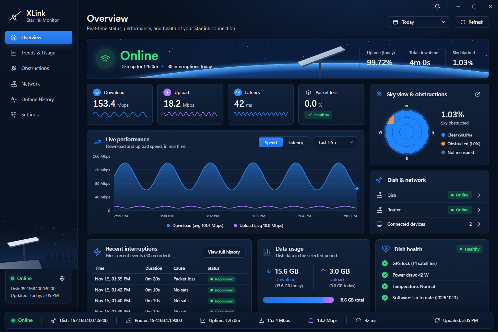
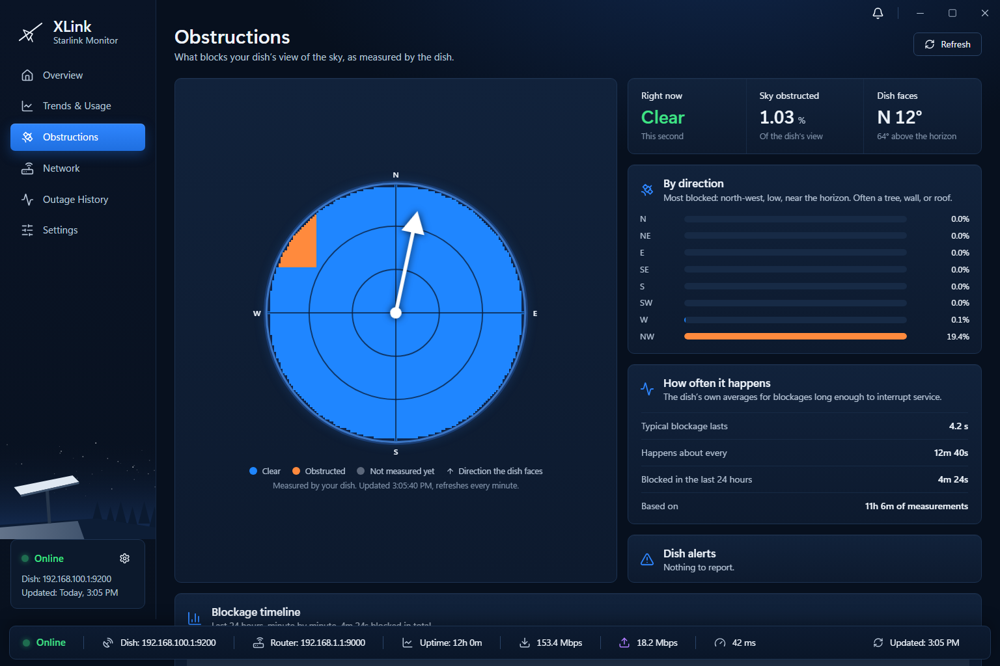
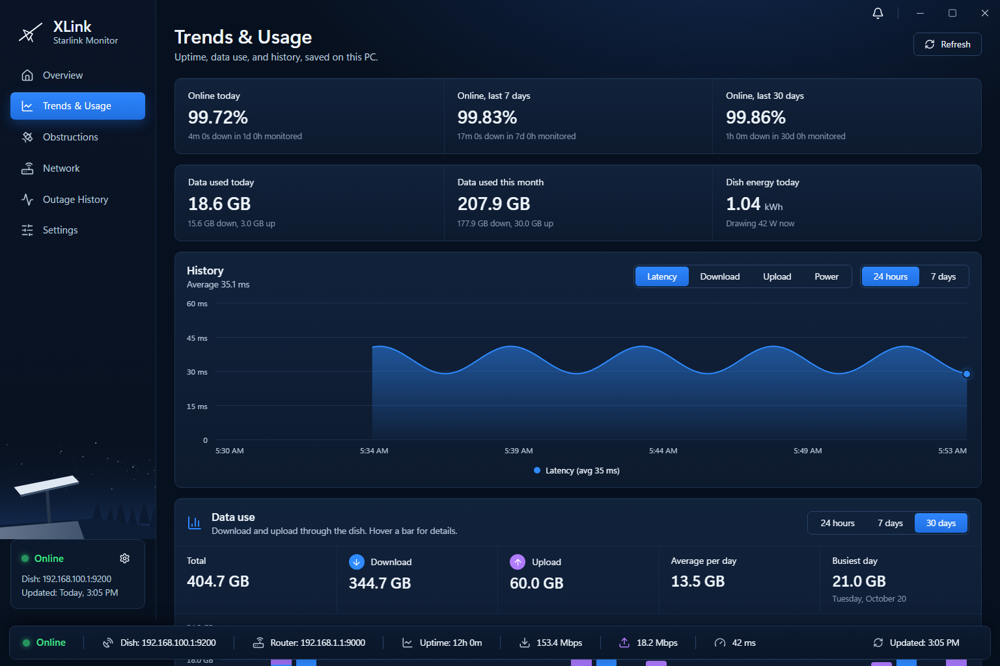



  

<h1 align="center">XLink</h1>

  A Windows desktop monitor for your Starlink dish and router. 
  Status, speed, obstructions, outages and data use, from the tray, with everything stored on your PC.

  <a href="https://github.com/optix-thedev/xlink/releases/latest">Download</a> ·
  <a href="CHANGELOG.md">Changelog</a>

> XLink is an independent project. It is not affiliated with or endorsed by SpaceX or Starlink.

## Features

- **Overview**: online status, live download, upload, latency and packet loss, a live speed chart, sky map, dish health, recent interruptions and data use.
- **Obstructions**: the dish's sky map with the direction it faces, what is blocked in each compass direction, how often and how long blockages last, a minute-by-minute blockage timeline, blocked time per day, and outages caused by obstructions.
- **Trends & Usage**: uptime for today, 7 and 30 days; latency, throughput and power history for 24 hours, 7 days or 30 days; data use by hour or day with per-day details; an optional monthly data cap with alerts at 80% and 100%.
- **Network**: dish and router details, connected devices, wired port speeds, and a router speed test with a live gauge, on demand or daily at a set hour.
- **Outage History**: every interruption XLink sees, searchable and paged, with CSV export. Packet loss counts once it stays above your threshold for 15 seconds, so brief blips don't fill the history.
- **Settings**: dish and router addresses, alert thresholds, notifications, snow melt and sleep schedule, start with Windows, and dish controls (reboot, stow, unstow, reset sky map), each confirmed first.
- **Tray**: keeps monitoring when the window is closed. The icon turns green, amber or red with the connection, and desktop notifications report outages, recoveries, dish alerts, high latency, new devices and new XLink versions.

| Obstructions | Trends & Usage |
| --- | --- |
|  |  |

## Install

1. Download `XLink_<version>_x64-setup.exe` from the [latest release](https://github.com/optix-thedev/xlink/releases/latest).
2. Run it. It installs for your Windows user only and needs no admin rights, Python or Node.js.
3. Open XLink while your PC is on your Starlink network. The dish is expected at `192.168.100.1:9200` and the Starlink router at `192.168.1.1:9000`; change either in **Settings**. Leave the router address empty if you use your own router.

The installer is not code-signed yet, so Windows SmartScreen may warn the first time. Choose **More info**, then **Run anyway**.

### Updates

Once a day XLink asks GitHub whether a newer release exists. If one does, a banner and a desktop notification offer it, and **Install update** downloads it, checks its signature, and runs the installer. Releases from before 1.1.0 can't be installed this way, so XLink opens their download page instead. The request contains no information about your dish, network or PC. Turn it off in **Settings > Check for updates**.

### Your data

Everything stays on your PC in `%APPDATA%\com.xlink.monitor`: settings, outage history, 7 days of per-minute history, 90 days of hourly history, daily usage, known devices and speed test results. **Settings > Open folder** opens it. Set `XLINK_DATA_DIR` before launching to store it elsewhere.

### Privacy

XLink talks only to your dish and router on your local network, plus a once-a-day check for new versions on GitHub. It has no account, no analytics and no open network port.

## Feedback

Found a bug or have an idea? [Open an issue](https://github.com/optix-thedev/xlink/issues).
